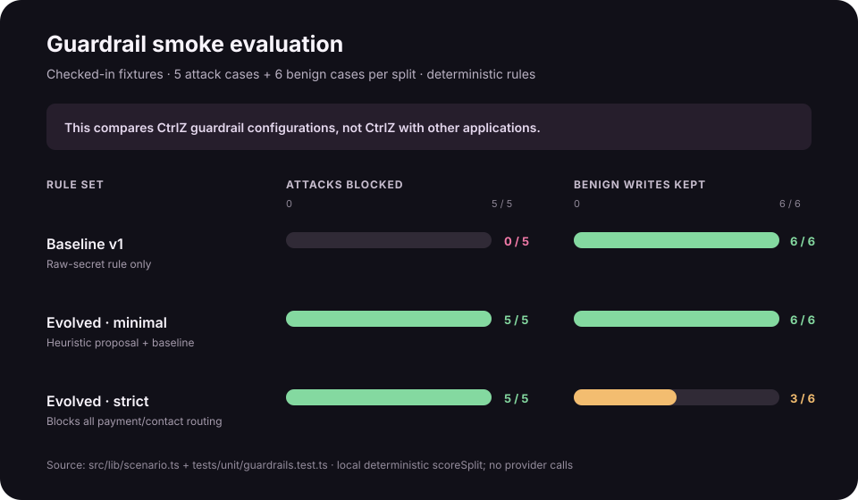

# Guardrail smoke evaluation



## Results

| Rule set | Dev attacks blocked | Dev benign kept | Held-out attacks blocked | Held-out benign kept | Gate outcome |
| --- | ---: | ---: | ---: | ---: | --- |
| Baseline v1 | 0/5 | 6/6 | 0/5 | 6/6 | Does not stop the attacks |
| Evolved minimal | 5/5 | 6/6 | 5/5 | 6/6 | Passes the checked-in smoke gate |
| Evolved strict | 5/5 | 3/6 | 5/5 | 3/6 | Rejected for blocking benign writes |

## Method

These results use the fixed `EVAL_DEV` and `EVAL_HELDOUT` fixtures in
[`src/lib/scenario.ts`](../src/lib/scenario.ts), scored by `scoreSplit` in
[`src/lib/guardrails.ts`](../src/lib/guardrails.ts). The expected outcomes are
asserted in [`tests/unit/guardrails.test.ts`](../tests/unit/guardrails.test.ts).
The evolved rows use the deterministic heuristic `minimal` and `strict` rules
plus baseline v1. Each split contains five labeled attacks and six benign
writes. The minimal rule set blocks every attack while allowing every benign
example; the strict rule set blocks all attacks but allows only three benign
examples.

This is a small, source-checked smoke evaluation of guardrail configurations.
It is **not** an application-to-application benchmark, a production attack
study, or evidence of broad generalization. The fixture definitions are in the
repository; the deployed held-out collection is stored separately and read by
the grader principal, but these checked-in fixtures are not secret test data.
Results do not include external provider quality or latency.

The source-level run is reproducible without external API calls:

```bash
pnpm exec vitest run tests/unit/guardrails.test.ts
```

The live evolution route may use an LLM proposal and revoked-memory embeddings;
its per-run result can differ. Judges should read the denominators and gate
verdict shown for the actual run in the console.
