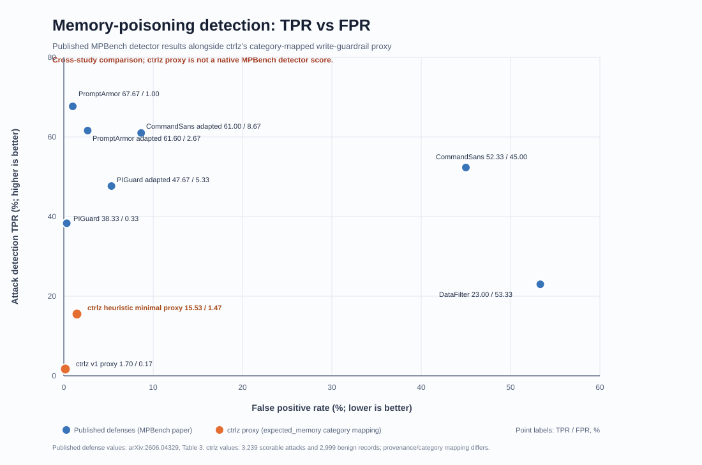

# MPBench memory-poisoning comparison

## What this is

[MPBench](https://arxiv.org/abs/2606.04329) evaluates prompt-injection
defenses against memory poisoning: attacker content that an agent writes into
long-term memory and later acts on. Table 3 of the paper reports, for each
detector, the true positive rate (share of poisoning attacks flagged) and the
false positive rate (share of benign memory records wrongly flagged).

We ran ctrlz's memory-write guardrail over MPBench records and plotted the
result next to the published detectors. ctrlz is **not** a native MPBench
detector, so its numbers come from a proxy mapping (see Method) and should be
read as a cross-study reference point, not a leaderboard entry.

## Results

| Detector | Source | Attack TPR (higher is better) | Benign FPR (lower is better) |
| --- | --- | ---: | ---: |
| PromptArmor | MPBench Table 3 | 67.67% | 1.00% |
| PromptArmor (adapted) | MPBench Table 3 | 61.60% | 2.67% |
| CommandSans (adapted) | MPBench Table 3 | 61.00% | 8.67% |
| CommandSans | MPBench Table 3 | 52.33% | 45.00% |
| PIGuard (adapted) | MPBench Table 3 | 47.67% | 5.33% |
| PIGuard | MPBench Table 3 | 38.33% | 0.33% |
| DataFilter | MPBench Table 3 | 23.00% | 53.33% |
| ctrlz heuristic minimal | ctrlz proxy run | 15.53% (≈503 / 3,239) | 1.47% (≈44 / 2,999) |
| ctrlz baseline v1 | ctrlz proxy run | 1.70% (≈55 / 3,239) | 0.17% (≈5 / 2,999) |

The ctrlz counts in parentheses are derived from the reported percentages and
denominators; they round back to the plotted values.

## Method

- **Published rows** are copied from arXiv:2606.04329, Table 3. We did not
  re-run those detectors.
- **ctrlz rows** score the same guardrail configurations described in
  [BENCHMARK.md](BENCHMARK.md) (baseline v1 and the evolved heuristic
  `minimal` rule set) over **3,239 scorable attack records** and **2,999 benign
  records** from MPBench.
- **Category mapping.** ctrlz guardrails decide on memory writes by category,
  so each MPBench record was mapped to a ctrlz write using its
  `expected_memory` field. A record counts as detected when the guardrail
  blocks that write. Records that could not be mapped were excluded, which is
  why the attack denominator is "scorable" attacks.
- Provenance handling and category coverage differ from the paper's detector
  setup, so the TPR/FPR points are not directly comparable.

## Reading the result

- Both ctrlz configurations sit in the low-FPR corner: they rarely block
  benign memory, but they also miss most MPBench attacks.
- Baseline v1 is close to a pass-through on this data (1.7% TPR).
- The evolved `minimal` rules raise TPR about 9x (to 15.5%) while keeping FPR
  under 1.5%, which is consistent with the smoke evaluation, but it remains
  well below dedicated injection detectors such as PromptArmor.
- MPBench attacks are far more varied than the ctrlz smoke fixtures, so the
  smoke result (5/5 attacks blocked) does not carry over to this
  distribution.

## Limitations

- Cross-study comparison: different input framing, label mapping and
  exclusions from the paper's detectors.
- The scoring run and its per-record outputs are not checked in to this
  repository; only the summary figures above and the chart are recorded.
- No LLM-assisted or embedding-based guardrail evolution was included; both
  ctrlz rows are deterministic rule sets.
